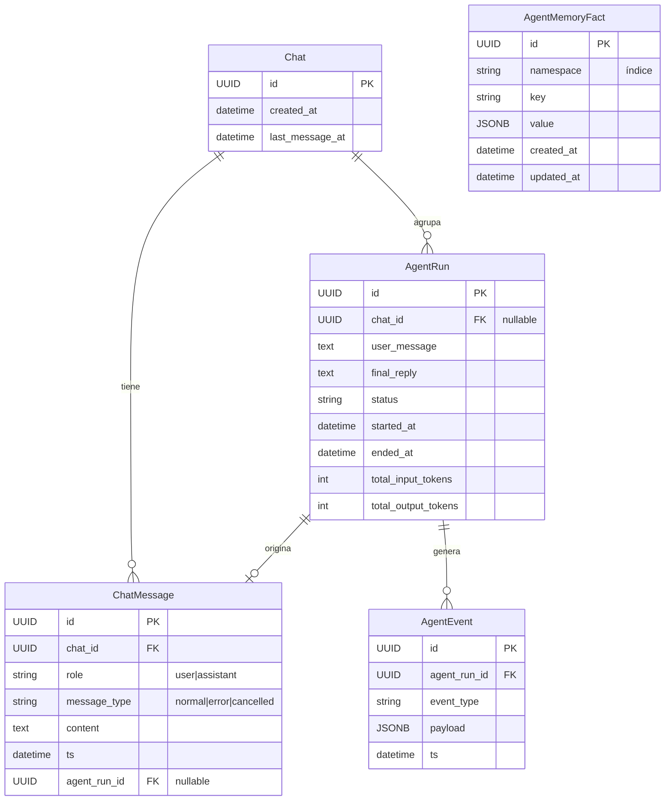
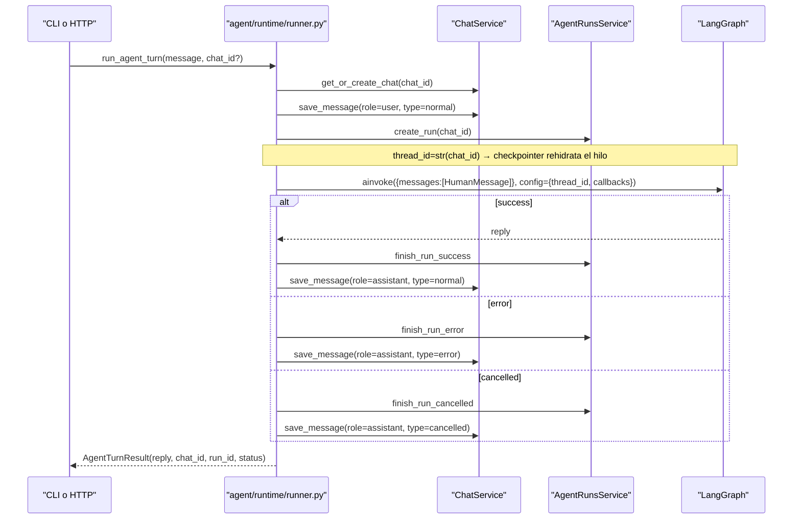
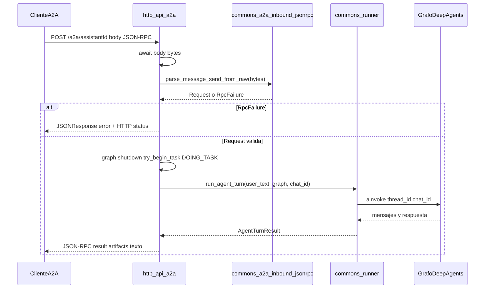
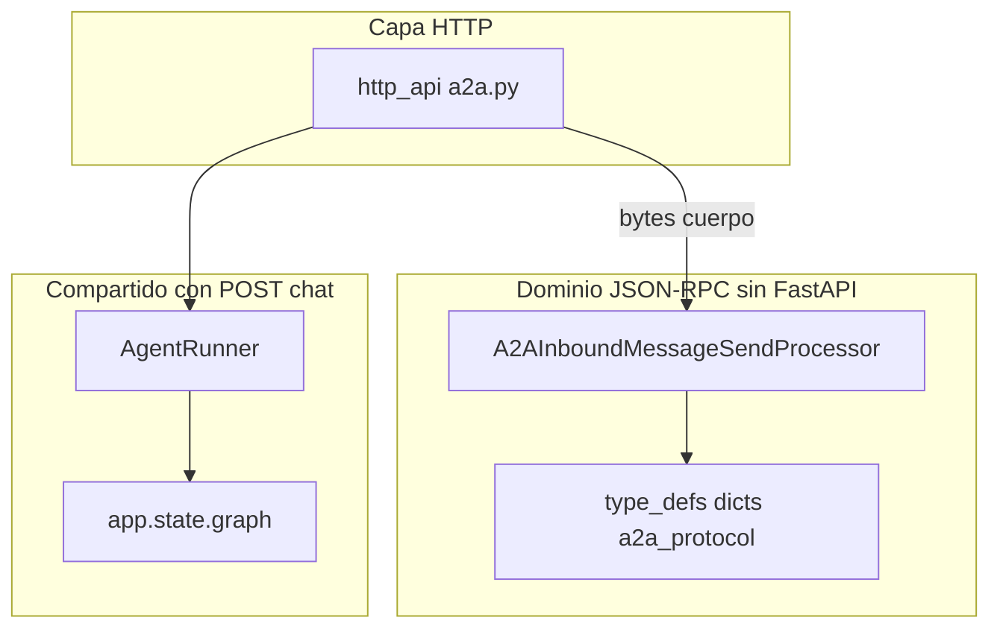
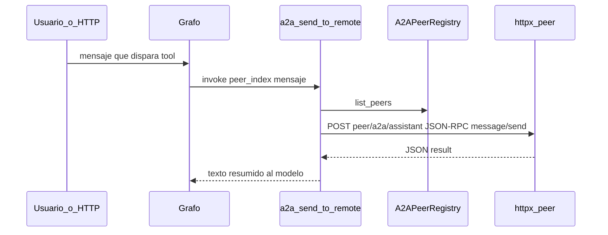
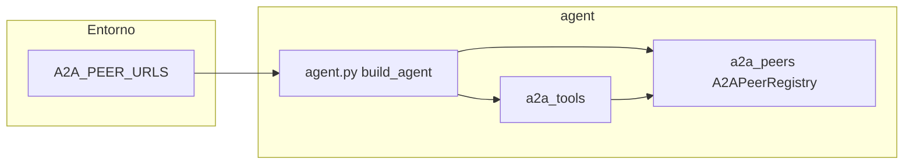

# Arquitectura

Resumen del diseño de **agent-bmc** y del servicio HTTP.

## Capa BMC (nueva en agent-bmc)

La integración con BMC Helix AR se reparte por capas (`config/bmc_settings.py`, `constants/bmc/`, `type_defs/models/bmc/`, `commons/bmc/`, `services/bmc/`). No expone servidor MCP; sus operaciones son herramientas internas de LangChain.

### Componentes

| Módulo | Responsabilidad |
|--------|----------------|
| `config/bmc_settings.py` | `BmcSettings` — lee variables `BMC_*` del entorno |
| `services/bmc/connection_manager.py` | Singleton JWT: login al arranque, refresh automático en background |
| `services/bmc/api_client.py` | `BmcClient` — métodos HTTP async por formulario AR; retry 401 automático |
| `services/bmc/tool_handler.py` | `BaseToolHandler` — write guard, encodificación TOON, carga de adjuntos |
| `constants/bmc/` | Nombres de campos AR, catálogos de estados, mensajes de error |
| `commons/bmc/`, `services/bmc/*_operations.py` | Builders (AR query, entry values, multipart) y operaciones multi-paso (WO, incident) |
| `type_defs/models/bmc/`, `type_defs/enums/` | Modelos Pydantic de entrada/salida, enums de estado, tipos AR |

### Flujo de autenticación BMC

```
build_agent()
  │
  ├─ BmcConnectionManager.instance(BmcSettings())
  │   └─ start() → POST /api/jwt/login → JWT + cookies
  │       └─ background task: refresh cada (TTL - margin) segundos
  │
  └─ BmcClient.{método}()
      └─ _request_with_retry()
          ├─ Authorization: AR-JWT {token}  +  cookie jar
          └─ si 401 → refresh_session() → retry
```

### Herramientas internas BMC

`src/agent/internal_tools/bmc_tools.py` define 12 herramientas `@tool` (LangChain):

- **Health**: `bmc_health_check`
- **Work Orders**: `bmc_create_work_order`, `bmc_get_work_order`, `bmc_add_work_order_note`,
  `bmc_add_work_order_attachment`, `bmc_update_work_order_status`, `bmc_close_work_order`
- **Incidents**: `bmc_create_incident`, `bmc_get_incident`, `bmc_add_incident_note`,
  `bmc_add_incident_attachment`, `bmc_close_incident`

`bmc_close_work_order` y `bmc_close_incident` aplican guards de negocio antes de
escribir (`src/commons/bmc/ticket_guards.py`): rechazan cualquier escritura sobre
un ticket ya `Closed`, y el cierre además exige que el `Submitter` del ticket coincida
con el usuario de servicio BMC configurado. `bmc_add_incident_note`/
`bmc_add_incident_attachment` escriben contra `HPD:WorkLog` (no `WOI:WorkInfo`).

El esqueleto común de las escrituras con guardas (escritura habilitada → ticket resuelto → no `Closed` → guarda extra opcional → llamadas a BMC con `MCPClientError` convertido en salida fallida) vive en `src/commons/bmc/guarded_write.py` (`run_guarded_write`); `IncidentOperations` y `WorkOrderOperations` solo aportan los valores, la llamada al cliente y el mensaje. `work_log_fields` y la base `WorkLogInput` (`type_defs/inputs.py`) comparten los campos del work log, y `src/agent/internal_tools/ticket_tool_helpers.py` las piezas comunes de las tools de incidentes y WO.

`src/agent/internal_tools/bmc_staged_files_tools.py` añade `bmc_attach_staged_files`: sube a un Incidente o WO los archivos que otro agente dejó en la carpeta compartida (`BMC_ATTACHMENT_BASE_DIR/<staging_id>/` + `manifest.json`). La lógica vive en `src/services/bmc/staged_files.py` (`StagedFilesAttacher`, independiente de LangChain y del tipo de ticket mediante el puerto `TicketWriter`). Los bytes no pasan por el LLM: la tool solo recibe ids. `BaseToolHandler.load_attachment` confina toda lectura a `BMC_ATTACHMENT_BASE_DIR` (resuelve `..` y enlaces simbólicos).

Todas comparten un `BaseToolHandler` lazy-inicializado y retornan JSON con `{success, message}`.

---

## Arquitectura heredada de agent_forge

## Estructura del paquete

**Raíz del repo (fuera de `src/`):** carpeta `skills/` con guías locales. En **`agent-base`**: `skills/<stem>.md` y/o `skills/<dir>/SKILL.md`; catálogo XML en el system prompt + tool `skill_get_guide`. En **`deep-agent-base`**: formato Agent Skills (`skills/<nombre>/SKILL.md`; ejemplo versionado `skills/example/` — ver `.gitignore`) con `FilesystemBackend` y `skills=["/skills/"]`. Resumen: [`docs/skills-implementation.md`](skills-implementation.md). Memoria del agente (checkpointer, BD, `memory_*`): [`docs/MEMORIA.md`](MEMORIA.md).

**Carpeta `test/`** (raíz del repo): scripts de diagnóstico que suelen requerir Postgres (`test_runs.py`, `test_chats.py`) y **pytest** opcional tras `uv sync --group dev` — A2A con mocks (`test_a2a_*.py`), settings multi-instancia, catálogo de skills (`test_skill_catalog.py`, `tmp_path`) y flujo LLM determinista con `GenericFakeChatModel` (`test_fake_llm_tool_flow.py`, sin Ollama ni red). Inventario y comandos: [`test/README.md`](../test/README.md).

Paquetes bajo `src/` (estructura plana, sin carpeta intermedia). El orden de arriba abajo es el **sentido de dependencia**: un paquete solo importa de los que tiene **antes** en la lista (`type_defs`, `constants` y `exception` son la base; `http_api` es la capa más alta).

### Reglas de estructura

1. **Capas:** `type_defs`/`constants`/`exception` < `commons` < `config` < `database` < `services` < `agent` < `http_api`. Nada importa hacia arriba (hoy hay **0** imports hacia arriba).
2. **Un archivo, una responsabilidad:** los **tipos** (dataclass, `TypedDict`, `NamedTuple`, `Protocol`, `Enum`, alias `Literal`, modelos Pydantic) viven solo en `type_defs/`; las **constantes públicas** en `constants/` (una por dominio); los **servicios y clases**, solos en su módulo. Las constantes privadas de un módulo (`_X`) y los objetos con comportamiento (`ContextVar`, sesión, `Settings`) se quedan donde se usan.
3. **Conjuntos cerrados = `StrEnum`** en `type_defs/enums/` (estados de WO/incidente, motivos de archivos omitidos): una sola fuente de verdad; las tuplas de `constants/bmc/tickets.py` se derivan de ellos.
4. **`commons/` es puro:** nada de `config`, base de datos ni agente. Lo que necesita `Settings`, la base de datos o el agente va en `services/`, `agent/` o `http_api/`.
5. **Nada suelto:** ni `commons/` ni `services/` acumulan archivos en la raíz; cada archivo va en un subpaquete por dominio (`text`, `a2a`, `bmc`; `persistence`, `bmc`, `startup`).
6. **Dónde va algo nuevo:** tipo → `type_defs/models/<dominio>/`; contrato entre capas → `type_defs/ports/<dominio>.py`; valor fijo → `constants/<dominio>.py`; lógica sin dependencias → `commons/<dominio>/`; acceso a base de datos → `services/persistence/`; cliente externo → `services/bmc/`; tool del LLM → `agent/internal_tools/`.
7. **Excepciones documentadas:** `services/bmc/handler_context.py` (`TicketHandlerContext`, un `Protocol` cuyos miembros son tipos de la capa de servicios) vive en `services/`; `constants/bmc/defaults.py` lee el entorno al importarse; `type_defs/enums/bmc_status.py` conserva los validadores pequeños que necesitan los tipos `Annotated` de Pydantic.

### Mapa de módulos (generado de las primeras líneas de cada docstring)

- **`type_defs/`** — tipos, sin lógica: `models/` (TypedDict, dataclasses y modelos Pydantic de BMC por dominio), `enums/` (conjuntos cerrados: `StrEnum`), `ports/` (contratos `Protocol`) y `http/` (modelos Pydantic de la API).
  - **`type_defs/enums/`** — Conjuntos cerrados de valores.
    - `bmc.py`: Conjuntos cerrados de valores de BMC: motivos por los que no se sube un archivo de la carpeta compartida.
    - `bmc_status.py`: BMC ticket status enumerations (selection values sent as ``Status`` in AR API).
    - `domain_literals.py`: Literales compartidos para estados de runs, mensajes y roles (sin duplicar uniones).
    - `event_types.py`: Valores de ``event_type`` para trazas (callbacks → ``agent_events``).
  - **`type_defs/http/`** — Modelos Pydantic para contratos HTTP de AgentForge.
    - `chat.py`: Schemas Pydantic para los endpoints de chat.
    - `people.py`: Pydantic schemas for the sender verification endpoint.
    - `runs.py`: Schemas para endpoints de runs y estadísticas.
    - `status.py`: Schemas Pydantic para el estado del agente.
  - **`type_defs/models/a2a/`** — Modelos del protocolo A2A.
    - `a2a.py`: Tipos de dominio para el cliente A2A (peers remotos).
    - `a2a_protocol.py`: Tipos estructurados para JSON-RPC A2A (inbound AgentForge y outbound hacia peers).
    - `inbound.py`: Modelos de la entrada JSON-RPC A2A (``message/send``).
  - **`type_defs/models/agent/`** — Modelos del agente: turnos, memoria, eventos y skills.
    - `agent_memory.py`: TypedDicts para los resultados serializados de MemorySerializer.
    - `agent_turn.py`: Dataclasses que representan el resultado y el contexto de un turno de conversación.
    - `chat_stream.py`: Eventos de streaming de chat (SSE) — tipos de alambre servidor → cliente.
    - `event_payloads.py`: TypedDicts para los payloads de eventos que se persisten en agent_events.
    - `search_results.py`: TypedDicts para los resultados de búsqueda del chat service.
    - `skill_catalog.py`: TypedDicts para el catálogo de skills locales.
    - `store.py`: TypedDicts para el store cross-thread de AgentForge (AgentPostgresStore).
  - **`type_defs/models/bmc/`** — Modelos de BMC Helix: respuestas AR, valores, entradas y salidas de las tools.
    - `ar_api.py`: Parsed BMC AR REST API response models.
    - `ar_values.py`: BMC AR API ``values`` payloads (Pydantic; field aliases match AR names).
    - `inputs.py`: Input validation models for MCP tool parameters.
    - `json_types.py`: JSON-compatible value types for BMC API payloads (no Any).
    - `outputs.py`: Output models returned by MCP tools.
    - `person.py`: Resultados de buscar a una persona en CTM:People.
    - `staged_outcome.py`: Resultado acumulado de subir los archivos de una carpeta compartida.
    - `ticket_state.py`: Campos de un ticket leídos de una búsqueda para las guardas de escritura.
  - **`type_defs/models/common/`** — Modelos genéricos compartidos.
    - `json_types.py`: Alias de tipos para estructuras JSON arbitrarias.
  - **`type_defs/ports/`** — Contratos (Protocol) entre capas.
    - `agent.py`: Protocolos de callable usados en el agente IA.
    - `bmc.py`: Contratos de BMC: guarda de escritura y escritor de un ticket.
- **`constants/`** — constantes públicas, un módulo por dominio.
  - `a2a.py`: Constantes del protocolo A2A (JSON-RPC inbound y rutas HTTP relativas).
  - `agent.py`: Constantes del agente: prompts, LLM, observabilidad, vistas previas y fechas.
  - `config.py`: Constantes de configuración: patrones, límites y niveles de log.
  - `database.py`: Constantes de base de datos: longitudes de columna, separadores y SQL fijo.
  - `startup.py`: Constantes del autochequeo de arranque.
  - **`constants/bmc/`** — Constantes de BMC Helix: campos AR, mensajes, API, tickets y valores por defecto.
    - `api.py`: Rutas, cabeceras, cookies, tiempos y partes multipart de la API REST de BMC.
    - `defaults.py`: Business-specific default values for BMC ticket creation.
    - `fields.py`: Nombres de los campos AR de BMC Helix.
    - `messages.py`: Mensajes de error para el usuario de las herramientas de BMC.
    - `staged.py`: Constantes de los archivos de adjuntos de la carpeta compartida.
    - `tickets.py`: Estados, valores por defecto y límites de incidentes y órdenes de trabajo.
- **`exception/`** — excepciones de dominio (`AgentError`, `ToolAgentError`, errores del cliente BMC/MCP).
  - `exceptions.py`: Jerarquía de excepciones del agente IA.
  - `mcp.py`: MCP-related exceptions with actionable error messages.
- **`commons/`** — lógica **pura** y reutilizable por dominio (`text`, `a2a`, `bmc`); no importa `config`, base de datos, servicios ni agente.
  - **`commons/a2a/`** — Lógica pura del protocolo A2A.
    - `reply_text.py`: Extract visible text from A2A ``message/send`` JSON-RPC result payloads.
  - **`commons/bmc/`** — Lógica pura de BMC Helix: consultas AR, mapeo de valores, multipart, guardas de tickets y codificación TOON.
    - `ar_query_builder.py`: Build AR System qualification strings for GET entry queries.
    - `entry_values_mapper.py`: Map Pydantic AR value models to JSON-compatible dicts.
    - `guarded_write.py`: Shared skeleton of the guarded ticket writes (incidents and work orders).
    - `multipart_builder.py`: Build multipart form data for ``WOI:WorkInfo`` entries.
    - `ticket_guards.py`: Pure business-rule guards for ticket write operations (status and ownership).
    - `toon_encoder.py`: TOON encoding for token-efficient tool responses.
  - **`commons/text/`** — Utilidades de texto puras.
    - `utils.py`: Utilidades generales del proyecto.
- **`config/`** — configuración (`Settings`, `BmcSettings`), logger y catálogo de skills.
  - `bmc_settings.py`: MCP and BMC configuration via Pydantic Settings.
  - `logger.py`: Loggers para AgentForge.
  - `logging_config.py`: Application logging: console plus rotating file under ``logs/``.
  - `settings.py`: Configuración de AgentForge.
  - `skill_catalog.py`: Catálogo y lectura segura de skills (guías Markdown bajo `skills/`).
- **`database/`** — motor, modelos SQLAlchemy, checkpointer y store.
  - `checkpointer.py`: Gestión del ciclo de vida del checkpointer de LangGraph con Postgres.
  - `config.py`: Configuración de base de datos para el motor SQLAlchemy y Alembic.
  - `engine.py`: Motor de la base de datos.
  - `models.py`: Modelos de la base de datos.
  - `store.py`: Store persistente en Postgres para memoria cross-thread de LangGraph.
- **`services/`** — acceso a datos y clientes externos: `persistence/`, `bmc/` (cliente AR, conexión JWT, operaciones de WO/incidente, personas, adjuntos), `startup/`.
  - **`services/bmc/`** — Cliente de BMC Helix AR, sesión, operaciones sobre tickets y archivos de adjuntos.
    - `api_client.py`: Async HTTP client for the BMC Helix AR REST API.
    - `connection_manager.py`: Singleton BMC session: JWT login, cookie jar, and background refresh.
    - `handler_context.py`: Contrato del manejador de las operaciones sobre tickets.
    - `incident_operations.py`: Incident write operations shared by agent tools.
    - `person_lookup.py`: Resolve a ticket reporter's real identity (First/Last Name) via BMC's CTM:People.
    - `staged_files.py`: Attach to a BMC ticket the files another agent staged in the shared folder.
    - `tool_handler.py`: Base helpers for MCP tool handlers.
    - `work_order_operations.py`: Work order write operations shared by agent tools.
  - **`services/persistence/`** — Servicios de persistencia en Postgres (chats, runs, eventos y memoria).
    - `agent_events_service.py`: Persistencia de eventos de traza por ejecución (callbacks LLM/tools).
    - `agent_runs_service.py`: Agent run persistence: lifecycle writes and read queries for tools/API.
    - `agent_runs_stats_service.py`: Agregaciones y estadísticas sobre ejecuciones del agente (solo lectura).
    - `chat_service.py`: Servicio para gestión de chats y mensajes de conversación.
    - `memory_serializer.py`: Serialize DB rows to compact dicts for LLM context (memory tools).
  - **`services/startup/`** — Autochequeos de arranque.
    - `preflight.py`: Startup self-check: confirm BMC knows the ``CTM:People`` status field the sender verification relies on.
- **`agent/`** — agente LangGraph: `runtime/`, `observability/`, `internal_tools/`, `interceptors/`, `llm.py`, `prompts.py`, `cli.py`.
  - `__main__.py`: Punto de entrada del paquete para ejecutar el CLI con `python -m agent`.
  - `a2a_peers.py`: Cliente A2A hacia agentes remotos y registro de peers (Agent Card).
  - `agent.py`: BMC agent LangGraph build context manager.
  - `cli.py`: CLI para AgentForge.
  - `llm.py`: LLM factory (Ollama, OpenAI, or Anthropic).
  - `mcp_tools.py`: MCP tools usando Streamable HTTP.
  - `prompts.py`: Carga el system prompt desde archivos, Langfuse o variables de entorno.
  - `tool_error_policy.py`: Central policy: tool failures become ToolMessage content instead of aborting the turn.
  - **`agent/interceptors/`** — Interceptors/callbacks para instrumentar el agente (LLM + tools/MCP).
    - `agent_run_callback.py`: Callback handler que instrumenta una ejecución del agente asociada a agent_run_id.
  - **`agent/internal_tools/`** — Internal agent tools: memory, skills, A2A peers, datetime and BMC Helix.
    - `a2a_tools.py`: Internal LangChain tools for outbound A2A delegation to remote agents.
    - `bmc_incident_tools.py`: Incident LangChain tools for agent-bmc.
    - `bmc_staged_files_tools.py`: LangChain tool that attaches staged files (shared folder) to an Incident or Work Order.
    - `bmc_tools.py`: BMC LangChain internal tools for agent-bmc: health check and registry.
    - `bmc_work_order_tools.py`: Work Order LangChain tools for agent-bmc.
    - `datetime_tools.py`: Internal tool exposing the current date/time, localized to the agent's timezone.
    - `memory_tools.py`: Internal memory tools for the LLM to query chats, runs and current state.
    - `skill_tools.py`: Internal tools for reading Markdown skill guides under `skills/`.
    - `ticket_tool_helpers.py`: Pieces shared by the incident and work order tools.
  - **`agent/observability/`** — Trazas y callbacks del agente (Langfuse y persistencia de eventos).
    - `interceptor_helpers.py`: Helpers para los interceptors (callbacks) que persisten eventos del agente.
    - `langfuse_tracing.py`: Registro del cliente Langfuse para que el callback de LangChain resuelva credenciales.
  - **`agent/runtime/`** — Ejecución de un turno del agente: runner y respuesta final.
    - `last_ai_reply.py`: Extracción de la respuesta final visible al usuario desde mensajes de LangGraph.
    - `runner.py`: AgentRunner: orquesta un turno completo de conversación.
- **`http_api/`** — servicio FastAPI (app, lifecycle, A2A entrante, routers).
  - `a2a.py`: Protocolo A2A (JSON-RPC) embebido en la misma app FastAPI que POST /chat.
  - `a2a_jsonrpc.py`: Validación y utilidades JSON-RPC A2A inbound ``message/send`` (sin FastAPI).
  - `agent_turn_guard.py`: Reserva/registra el estado DOING_TASK/UP de un turno (HTTP y A2A inbound).
  - `app.py`: Servicio HTTP de AgentForge (FastAPI).
  - `chat_handler.py`: Helpers del endpoint HTTP de chat.
  - `lifecycle.py`: Helpers para el ciclo de vida del agente en el servicio HTTP (FastAPI).
  - `state.py`: Estado compartido del agente (uso en servicio HTTP).
  - **`http_api/routers/`** — Routers FastAPI agrupados por dominio.
    - `people_routes.py`: Sender verification: lets another service check that an email belongs to an enabled BMC person.
    - `rest_routes.py`: Rutas REST principales: estado, chat, consultas y ciclo de vida del agente.

## Modelo de datos



> Además de las tablas anteriores, LangGraph crea automáticamente las tablas `langgraph_checkpoint_*` al llamar a `saver.setup()`. Estas las gestiona el checkpointer de forma transparente; **no** aparecen en los modelos SQLAlchemy del proyecto.

## Flujo de un turno (CLI o HTTP)



## Endpoints del servicio HTTP

| Método | Ruta | Descripción |
|--------|------|-------------|
| GET | `/status` | Estado del agente (`DOWN`, `UP`, `DOING_TASK`) |
| POST | `/chat` | Envía mensaje; acepta `chat_id` opcional; devuelve `chat_id`, `run_id`, `status` |
| POST | `/chat/stream` | Mismo cuerpo que `/chat`; respuesta SSE (`chunk`, `done`, `error`) |
| GET | `/chats` | Lista chats recientes |
| GET | `/chats/{chat_id}/messages` | Historial de mensajes de un chat |
| GET | `/runs/last` | Última ejecución con eventos |
| GET | `/runs/stats` | Estadísticas de tokens y tiempos |
| POST | `/start` | Arranca el agente |
| POST | `/stop` | Para el agente |
| GET | `/.well-known/agent-card.json` | Agent Card A2A (`assistant_id` query = `A2A_ASSISTANT_ID`) |
| POST | `/a2a/{assistant_id}` | JSON-RPC A2A; método soportado: `message/send` (mismo grafo que `/chat`) |

- `POST /chat`, `POST /chat/stream` y A2A permiten turnos concurrentes por defecto
  (`HTTP_ALLOW_CONCURRENT_TURNS=1`). Con `=0` responden `409` si el agente ya está
  ocupado (`DOING_TASK`) — un run por turno. En ambos casos un contador interno
  (`AgentState.try_begin_task`/`end_task`) mantiene `GET /status` en `DOING_TASK`
  mientras quede al menos un turno en curso, y lo vuelve a `UP` cuando termina el
  último.
- Los mensajes de tipo `error` y `cancelled` aparecen en el historial del chat pero no se inyectan como contexto al LLM.
- `agent_runs.chat_id` es nullable para retrocompatibilidad con runs anteriores.

## A2A (Agent2Agent): archivos, capas y flujos

A2A en AgentForge se divide en **inbound** (este proceso actúa como servidor JSON-RPC + Agent Card) y **outbound** (el mismo grafo llama a otros agentes vía HTTP). Variables: ver [`README.md`](../README.md) y [`.env.example`](../.env.example).

### Inventario de archivos

| Rol | Ruta | Responsabilidad |
|-----|------|-----------------|
| Inbound HTTP | [`src/http_api/a2a.py`](../src/http_api/a2a.py) | Router FastAPI: `GET /.well-known/agent-card.json`, `POST /a2a/{assistant_id}`; `HTTPException`/`JSONResponse`; reserva el turno en `agent_state` (`try_begin_task`/`restore_agent_up_after_turn`; `409` si está ocupado con `HTTP_ALLOW_CONCURRENT_TURNS=0`); delega parseo a `commons` y turno a `get_agent_runner()`. |
| Inbound parseo (sin FastAPI) | [`src/http_api/a2a_jsonrpc.py`](../src/commons/a2a_inbound_jsonrpc.py) | `A2AInboundMessageSendProcessor`: validar cuerpo JSON-RPC `message/send` → `A2AInboundMessageSendRequest` o `A2AInboundRpcFailure`; `@staticmethod` `jsonrpc_error`, `extract_text_from_parts`, `build_message_send_success`, `build_agent_forge_agent_card`. |
| Tipos A2A | [`src/type_defs/models/a2a/a2a_protocol.py`](../src/type_defs/models/a2a/a2a_protocol.py), [`src/type_defs/models/a2a/a2a.py`](../src/type_defs/models/a2a/a2a.py) | TypedDict / alias JSON-RPC y Agent Card; `PeerInfo`. |
| Outbound cliente | [`src/agent/a2a_peers.py`](../src/agent/a2a_peers.py) | `A2APeerRegistry`, `fetch_agent_card`, `a2a_message_send` (httpx); registro enlazado al grafo (`bind_a2a_registry_to_graph`). |
| Outbound tools | [`src/agent/internal_tools/a2a_tools.py`](../src/agent/internal_tools/a2a_tools.py) | Tools LangChain `a2a_list_remote_agents`, `a2a_send_to_remote` (cierran sobre `A2APeerRegistry`). |
| Montaje grafo | [`src/agent/agent.py`](../src/agent/agent.py) | Si `normalized_a2a_peer_configs()` no está vacío, carga registry y añade tools A2A al `create_agent`. |
| Config | [`src/config/settings.py`](../src/config/settings.py) | `A2A_ASSISTANT_ID`, `A2A_PROTOCOL_VERSION`, `A2A_PEER_URLS` (`url|assistant_id` por entrada), `normalized_a2a_peer_configs()`. |

### Inbound: solo `agent-forge-http`

La CLI **no** expone `/.well-known` ni `POST /a2a/...`. Un cliente A2A habla HTTP con el mismo proceso que sirve `/chat`; el turno reutiliza `app.state.graph` y `AgentRunner.run_agent_turn` (misma persistencia de chats/runs).





### Outbound: mismo grafo en CLI y HTTP

Si `A2A_PEER_URLS` contiene entradas válidas en formato `url_base|assistant_id` (separadas por comas), al construir el agente se descarga el Agent Card de cada peer y el modelo puede usar las tools `a2a_list_remote_agents` / `a2a_send_to_remote` (cliente httpx hacia el peer). Entradas mal formadas se omiten.





### Referencias de diseño

- Guía operativa A2A: [`docs/A2A.md`](A2A.md).
- Guía operativa MCP: [`docs/MCP.md`](MCP.md).

## Logs

- **Core** (archivo `logs/agent_<AGENT_SLUG>.log`, default `logs/agent_agent_forge.log`): todo lo que escribe el root logger y el logger `agent_forge`, incluidas librerías (p. ej. httpx/httpcore).
- **Usuario** (consola): solo el logger `agent_forge.user`, para mensajes pensados para el usuario en la CLI.

## Herramientas de lint

- **Ruff**: validación **rápida y en tiempo real** en el IDE; configuración en **`ruff.toml`**; CLI típica `uv run ruff check src`.
- **Pylint**: análisis **antes de merge** (merge requests / CI); configuración en **`.pylintrc`** en la raíz; ejemplo `uv run pylint --rcfile=.pylintrc src`.
