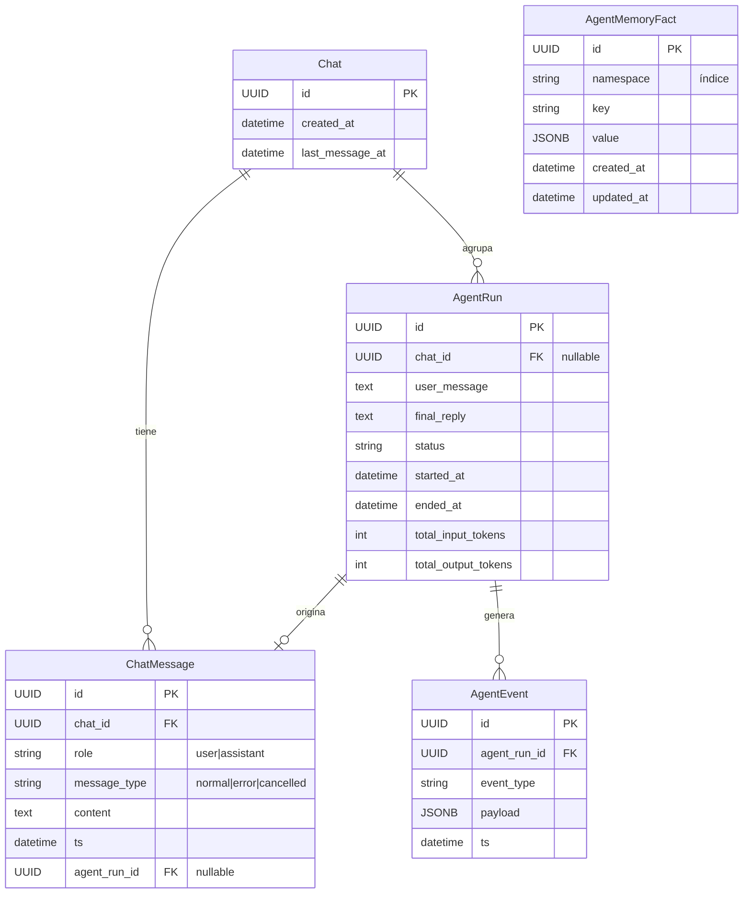
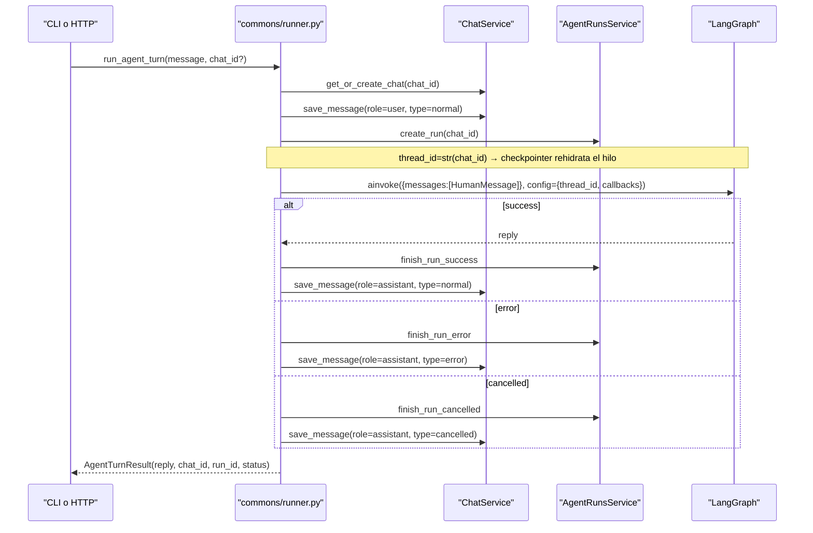
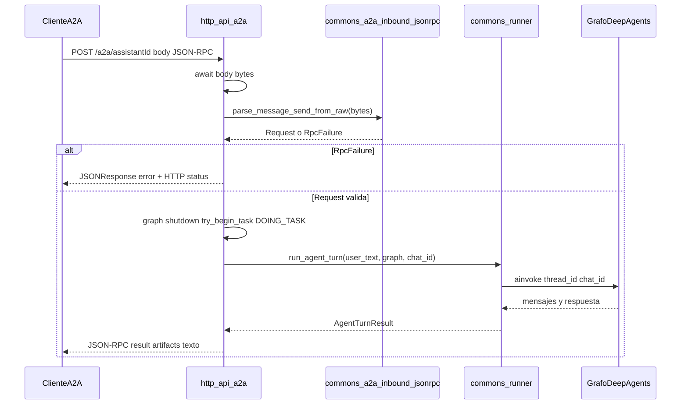
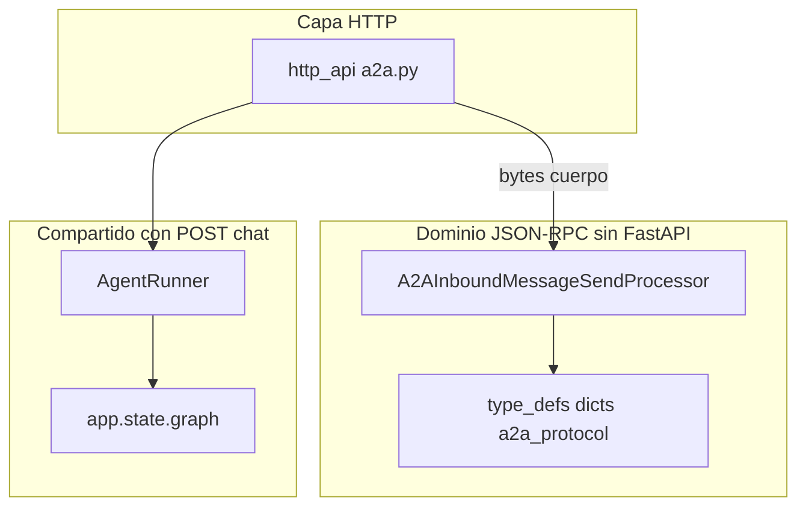
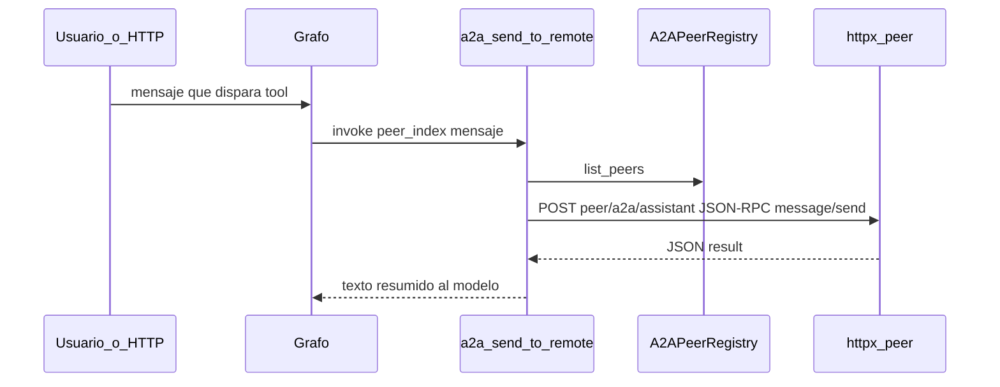
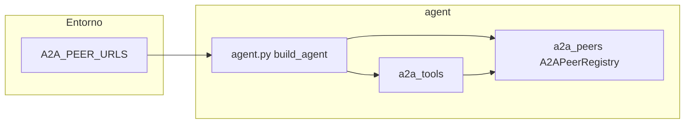

# Arquitectura

Resumen del diseño de **agent-bmc** y del servicio HTTP.

## Capa BMC (nueva en agent-bmc)

El paquete `src/bmc/` encapsula toda la lógica de integración con BMC Helix AR. No expone servidor MCP; sus operaciones son herramientas internas de LangChain.

### Componentes

| Módulo | Responsabilidad |
|--------|----------------|
| `bmc/config/settings.py` | `BmcSettings` — lee variables `BMC_*` del entorno |
| `bmc/libs/connection_manager.py` | Singleton JWT: login al arranque, refresh automático en background |
| `bmc/libs/api_client.py` | `BmcClient` — métodos HTTP async por formulario AR; retry 401 automático |
| `bmc/libs/tool_handler.py` | `BaseToolHandler` — write guard, encodificación TOON, carga de adjuntos |
| `bmc/libs/constants.py` | Nombres de campos AR, catálogos de estados, mensajes de error |
| `bmc/libs/helpers/` | Builders (AR query, entry values, multipart) y operaciones multi-paso (WO, incident) |
| `bmc/type_defs/` | Modelos Pydantic de entrada/salida, enums de estado, tipos AR |

### Flujo de autenticación BMC

```
build_agent()
  │
  ├─ BmcConnectionManager.instance(BmcSettings())
  │   └─ start() → POST /api/jwt/login → JWT + cookies
  │       └─ background task: refresh cada (TTL - margin) segundos
  │
  └─ BmcClient.{método}()
      └─ _request_with_retry()
          ├─ Authorization: AR-JWT {token}  +  cookie jar
          └─ si 401 → refresh_session() → retry
```

### Herramientas internas BMC

`src/agent/internal_tools/bmc_tools.py` define 12 herramientas `@tool` (LangChain):

- **Health**: `bmc_health_check`
- **Work Orders**: `bmc_create_work_order`, `bmc_get_work_order`, `bmc_add_work_order_note`,
  `bmc_add_work_order_attachment`, `bmc_update_work_order_status`, `bmc_close_work_order`
- **Incidents**: `bmc_create_incident`, `bmc_get_incident`, `bmc_add_incident_note`,
  `bmc_add_incident_attachment`, `bmc_close_incident`

`bmc_close_work_order` y `bmc_close_incident` aplican guards de negocio antes de
escribir (`src/bmc/libs/helpers/ticket_guards.py`): rechazan cualquier escritura sobre
un ticket ya `Closed`, y el cierre además exige que el `Submitter` del ticket coincida
con el usuario de servicio BMC configurado. `bmc_add_incident_note`/
`bmc_add_incident_attachment` escriben contra `HPD:WorkLog` (no `WOI:WorkInfo`).

El esqueleto común de las escrituras con guardas (escritura habilitada → ticket resuelto → no `Closed` → guarda extra opcional → llamadas a BMC con `MCPClientError` convertido en salida fallida) vive en `src/bmc/libs/helpers/guarded_write.py` (`run_guarded_write`); `IncidentOperations` y `WorkOrderOperations` solo aportan los valores, la llamada al cliente y el mensaje. `work_log_fields` y la base `WorkLogInput` (`type_defs/inputs.py`) comparten los campos del work log, y `src/agent/internal_tools/ticket_tool_helpers.py` las piezas comunes de las tools de incidentes y WO.

`src/agent/internal_tools/bmc_staged_files_tools.py` añade `bmc_attach_staged_files`: sube a un Incidente o WO los archivos que otro agente dejó en la carpeta compartida (`BMC_ATTACHMENT_BASE_DIR/<staging_id>/` + `manifest.json`). La lógica vive en `src/bmc/libs/helpers/staged_files.py` (`StagedFilesAttacher`, independiente de LangChain y del tipo de ticket mediante el puerto `TicketWriter`). Los bytes no pasan por el LLM: la tool solo recibe ids. `BaseToolHandler.load_attachment` confina toda lectura a `BMC_ATTACHMENT_BASE_DIR` (resuelve `..` y enlaces simbólicos).

Todas comparten un `BaseToolHandler` lazy-inicializado y retornan JSON con `{success, message}`.

---

## Arquitectura heredada de agent_forge

## Estructura del paquete

**Raíz del repo (fuera de `src/`):** carpeta `skills/` con guías locales. En **`agent-base`**: `skills/<stem>.md` y/o `skills/<dir>/SKILL.md`; catálogo XML en el system prompt + tool `skill_get_guide`. En **`deep-agent-base`**: formato Agent Skills (`skills/<nombre>/SKILL.md`; ejemplo versionado `skills/example/` — ver `.gitignore`) con `FilesystemBackend` y `skills=["/skills/"]`. Resumen: [`docs/skills-implementation.md`](skills-implementation.md). Memoria del agente (checkpointer, BD, `memory_*`): [`docs/MEMORIA.md`](MEMORIA.md).

**Carpeta `test/`** (raíz del repo): scripts de diagnóstico que suelen requerir Postgres (`test_runs.py`, `test_chats.py`) y **pytest** opcional tras `uv sync --group dev` — A2A con mocks (`test_a2a_*.py`), settings multi-instancia, catálogo de skills (`test_skill_catalog.py`, `tmp_path`) y flujo LLM determinista con `GenericFakeChatModel` (`test_fake_llm_tool_flow.py`, sin Ollama ni red). Inventario y comandos: [`test/README.md`](../test/README.md).

Paquetes bajo `src/` (estructura plana, sin carpeta intermedia):

- **type_defs/** — todo el tipado del proyecto concentrado aquí (el paquete no se llama `types` para no colisionar con el módulo estándar `types`):
  - **`type_defs/http/`** — modelos Pydantic (`BaseModel`) para contratos HTTP:
    - `chat.py`: `ChatRequest`, `ChatResponse`, `ChatMessageResponse`, `ChatSummaryResponse`.
    - `status.py`: `StatusAgent` (Literal), `StatusResponse`.
    - `runs.py`: `EventDetail`, `RunDetailResponse`, `RunTokensSummary`, `StatsResponse`.
  - **`type_defs/dicts/`** — TypedDicts, dataclasses, Protocols y aliases (sin Pydantic):
    - `domain_literals.py`: aliases `RunStatus`, `TurnStatus`, `StreamDoneStatus`, `MessageType`, `ChatRole` y constantes en runtime (`RUN_STATUS_*`, `MESSAGE_TYPE_*`, `ROLE_*`) compartidas por runner, servicios y modelos.
    - `event_types.py`: constantes `EVENT_LLM_*`, `EVENT_TOOL_*` y alias `AgentEventType` para trazas LLM/tool.
    - `agent_turn.py`: `AgentTurnResult`, `TurnContext` (dataclasses del ciclo de vida de un turno; `messages` contiene solo el mensaje nuevo del usuario — el historial lo gestiona el checkpointer).
    - `chat_stream.py`: eventos SSE del streaming HTTP (`ChatStreamChunkEvent`, `ChatStreamDoneEvent`, `ChatStreamErrorEvent`, `chat_stream_event_to_json_line`).
    - `protocols.py`: `LogFn` (Protocol para callbacks de logging estructurado; `payload: JsonDict`).
    - `search_results.py`: `ChatSearchResult` (TypedDict, retorno de `ChatService.search_chats`).
    - `json_types.py`: `JsonDict = dict[str, object]` — alias para JSONB y payloads de estructura arbitraria.
    - `event_payloads.py`: TypedDicts de payloads de eventos (`ToolResultLogEntry`, `LlmStartPayload`, `LlmEndPayload`, `LlmErrorPayload`, `ToolStartPayload`, `ToolEndPayload`, `ToolErrorPayload`).
    - `agent_memory.py`: TypedDicts para la salida de `MemorySerializer` (`AgentRunSummary`, `AgentEventSummary`, `ChatMessageSummary`).
    - `store.py`: `MemoryFactEntry`, `MemoryFactSearchResult` — tipos del store cross-thread.
    - `a2a.py`: dataclass `PeerInfo` (peer remoto tras Agent Card).
    - `a2a_protocol.py`: contratos JSON-RPC / Agent Card A2A (`JsonRpcId`, `JsonRpcErrorEnvelope`, `AgentForgeAgentCard`, `A2AInboundMessageSendSuccess`, partes de mensaje outbound, etc.).
    - `skill_catalog.py`: `SkillCatalogEntry` (stem y descripción breve del catálogo XML).
  - `__init__.py` raíz re-exporta todo (`http` + `dicts`) en un solo `__all__`.
  > Convención: todo el tipado del proyecto vive bajo `type_defs/`; `http/` para contratos Pydantic, `dicts/` para el resto. No existe paquete `schemas/` separado.
- **exception/** (`AgentError`, `AgentConfigError`, `ToolAgentError`): jerarquía de excepciones de dominio del agente.
  - `AgentError`: base; toda excepción del agente hereda de aquí.
  - `AgentConfigError`: errores de configuración (prompt vacío, settings inválidos).
  - `ToolAgentError`: hereda también `langchain_core.tools.ToolException`; errores lanzados desde tools con `handle_tool_error` activo pasan al LLM como `tool_result`.
- **config/** (configuración general; no depende de agent ni http_api):
  - `settings.py`: `Settings` (incluye `asyncpg_url` property para el checkpointer Postgres), `Settings.repo_root()`, `system_prompt_path()`, `skills_dir()`; multi-instancia: `agent_slug`, `agent_display_name`, `agent_card_description`, `system_prompt_env` / `system_prompt_path_env`, `resolved_system_prompt_file()`, `effective_a2a_assistant_id`, `effective_agent_display_name`, `effective_agent_card_description`; LLM: `llm_provider` (`ollama` \| `openai` \| `anthropic`), `openai_*`, `anthropic_*`; Langfuse: `langfuse_public_key`, `langfuse_secret_key`, `langfuse_host`, `langfuse_prompt_name`, `langfuse_prompt_label` (default `latest`), propiedad `langfuse_tracing_ready`; A2A: `a2a_assistant_id`, `a2a_protocol_version`, `a2a_peer_urls` y normalización `normalized_a2a_peer_configs()` (solo entradas `url|assistant_id`).
  - `logger.py`: `get_logger`, `get_user_logger`.
  - `skill_catalog.py` (`agent-base`): `discover_skill_entries`, `build_skills_catalog_xml`, `read_skill_guide_json`, validación de stem y lectura dual `*.md` / `*/SKILL.md`.
- **agent/** (núcleo del agente + CLI):
  - `__init__.py`: solo exporta `build_agent` (el CLI es `agent.cli:main` para evitar ciclos de importación con `commons.runner`).
  - `agent.py`: `build_agent` (context manager) — inicializa `CheckpointerManager`, `AgentPostgresStore`, LLM, compila el grafo con checkpointer + store, tools MCP, internas de memoria/skills y **tools A2A remotas** si `normalized_a2a_peer_configs()` devuelve al menos un peer. **Dos variantes según la rama**: en `deep-agent-base` usa `create_deep_agent` (`deepagents`) + `FilesystemBackend` (`virtual_mode=True`) con `skills=["/skills/"]`; en `agent-base` usa `create_agent` (LangChain estándar) + tool `skill_get_guide` + catálogo XML en el system prompt (sin `deepagents`).
  - `llm.py`, `mcp_tools.py`: fábrica de LLM (`build_llm`: Ollama / OpenAI / Anthropic según `Settings`; OpenAI/Anthropic con prompt caching por `agent_slug`), herramientas MCP (Streamable HTTP; URLs desde `Settings.mcp_urls`). Operación y límites: [`docs/MCP.md`](MCP.md).
  - `tool_error_policy.py`: `configure_tool_error_handling` — en `build_agent`, antes de `create_agent`, activa `handle_tool_error` en todas las tools; las excepciones de tool deben ser `ToolAgentError` (`ToolException`) para que el mensaje llegue al LLM en el `ToolMessage` sin abortar el turno.
  - `prompts.py`: `load_system_prompt_for_settings` (precedencia `SYSTEM_PROMPT` → Langfuse `LANGFUSE_PROMPT_NAME` con etiqueta `LANGFUSE_PROMPT_LABEL` en `get_prompt` → archivo `SYSTEM_PROMPT_PATH` o `system.promt.md`), concatena `base.prompt.md` si existe y, en `agent-base`, añade al final el bloque `<skills>` vía `finalize_system_prompt` + `build_skills_catalog_xml` (solo si hay guías; ver `config/skill_catalog.py`).
  - `cli.py`: REPL por consola; delega turnos a `AgentRunner` (`run_agent_turn` / `stream_agent_turn`); el checkpointer usa `thread_id=str(chat_id)`; si hay peers A2A outbound cargados lista en consola los remotos (no expone servidor A2A).
  - `a2a_peers.py`: cliente HTTP (`httpx`) hacia Agent Card y `message/send`; clase `A2APeerRegistry` (sin estado global) enlazada al grafo para tools y lectura desde la CLI. Tipos A2A/JSON-RPC: `type_defs/dicts/a2a.py` (`PeerInfo`), `type_defs/dicts/a2a_protocol.py` (TypedDict); JSON arbitrario: `JsonDict`.
  - `internal_tools/memory_tools.py`: solo las funciones `@tool` y `get_memory_tools`.
  - `internal_tools/skill_tools.py` (`agent-base`): `skill_get_guide`, `get_skill_tools`.
  - `internal_tools/a2a_tools.py`: tools `a2a_list_remote_agents` y `a2a_send_to_remote` (solo si tras normalizar `A2A_PEER_URLS` hay al menos un peer al construir el grafo).
- **http_api/** (servicio FastAPI):
  - `__init__.py`: vacío a propósito (no importa `app` al cargar el paquete; evita ciclo con `commons.agent_http`). Usar `http_api.app` para la app FastAPI.
  - `app.py`: crea la app FastAPI, lifespan (`start_agent`/`stop_agent`, `chat_tasks`), **CORS** desde `Settings` (`cors_origins`, `cors_allow_credentials`) e incluye routers `a2a` + `routers/rest_routes`.
  - `routers/people_routes.py`: `POST /people/verify` (¿el correo existe en `CTM:People` y está habilitado?). Lógica en `bmc/libs/helpers/person_lookup.py` (`verify_person_by_email`, mismo desempate que `resolve_reporter_identity`); protegido con `X-API-Key` frente a `BMC_VERIFY_API_KEY` (comparación en tiempo constante; sin clave configurada responde 503). Sin LLM: lo consume el mailer para validar el remitente antes de atender un correo.
  - `routers/rest_routes.py`: rutas REST `/status`, `/chat`, `/chat/stream`, `/chats`, `/runs`, `/start`, `/stop`, etc.
  - `agent_turn_guard.py`: reserva/registro de turno (`DOING_TASK` / restauración `UP` cuando no queda ninguno en curso) compartido por POST `/chat`, SSE `/chat/stream` y A2A JSON-RPC. Por defecto (`HTTP_ALLOW_CONCURRENT_TURNS=1`, `Settings`, fijado en `agent_state` al arrancar) permite varios turnos en paralelo; con `=0` rechaza (`409`) un turno nuevo mientras haya uno en curso.
  - `chat_handler.py`: `ChatHandler` — registro de `chat_tasks`, guardas (`graph`, `shutdown`) y ejecución del turno contra `AgentRunner`.
  - `a2a.py`: A2A **inbound** — `GET /.well-known/agent-card.json`, `POST /a2a/{assistant_id}` (JSON-RPC `message/send`). Constantes de protocolo y URLs auxiliares en `commons/a2a_constants.py`. Parseo en `commons/a2a_inbound_jsonrpc.py`. Mismo `app.state.graph` y `AgentRunner` que `/chat`.
  - `state.py`: `AgentState` y singleton `agent_state`; la propiedad `status` está tipada como `StatusAgent`.
- **commons/** (lógica compartida CLI + HTTP):
  - `__init__.py`: exporta solo `TextUtils` (evita cargar `agent_http`/`runner` al importar submódulos como `a2a_constants`).
  - `a2a_constants.py`: códigos JSON-RPC con nombre, mensajes de fallo A2A y helpers de URL (`well_known_agent_card_url`, `a2a_jsonrpc_url`).
  - `langfuse_tracing.py`: `ensure_langfuse_tracing_client` — instancia `Langfuse` una vez por `public_key` para que el callback de LangChain resuelva host/secret vía el gestor interno del SDK.
  - `last_ai_reply.py`: clase `ReplyExtractor` (instancia) — `from_messages(messages)` extrae la respuesta final visible; helpers privados de instancia (`_try_ai_no_tools`, `_try_ai_any`, `_try_tool_message`, `_tool_message_text`). Uso: `ReplyExtractor().from_messages(...)`.
  - `utils.py`: `parse_uuid_param` y clase `TextUtils` — `truncate(text, limit_chars)` como método estático público (sin estado).
  - `serializers/memory_serializer.py`: `MemorySerializer` (presentación de filas de BD para tools `memory_*`).
  - `interceptor_helpers.py`: clase `InterceptorHelpers` (instancia) — métodos de parseo de mensajes LangChain, conteo de tokens y resumen de tools. Helpers privados de instancia: `_first_generation_info`, `_as_dict`. Uso: `InterceptorHelpers()` o `self._helpers = InterceptorHelpers()`.
  - `agent_http.py`: `start_agent`, `stop_agent`.
  - `a2a_inbound_jsonrpc.py`: clase `A2AInboundMessageSendProcessor` — validación JSON-RPC `message/send` y builders (`jsonrpc_error`, `build_message_send_success`, `build_agent_forge_agent_card`); sin FastAPI.
  - `runner.py`: clase `AgentRunner` (singleton vía `get_agent_runner()`); `MessageConverter` (conversión `ChatMessage → LangChain`); métodos `run_agent_turn`, `stream_agent_turn`, `prepare_turn`, `finish_turn_*`; `build_graph_invoke_config` comparte `config` entre `ainvoke` y `astream` (callbacks de eventos propios + opcional `CallbackHandler` de Langfuse si `langfuse_tracing_ready`); en `agent-base` el mensaje al LLM es el texto del usuario sin prefijos (catálogo de skills en el system prompt); en `deep-agent-base` Deep Agents gestiona el descubrimiento de skills; usa `thread_id=str(chat_id)` en cada invocación del grafo; streaming de texto usa `InterceptorHelpers.llm_message_body_text` sobre `AIMessageChunk.content`.
- **agent/interceptors/**:
  - `AgentRunCallbackHandler`: callbacks async para capturar eventos LLM/tools por `agent_run_id`; `build_callbacks` classmethod; guarda `self._helpers = InterceptorHelpers()` para parseo interno.
- **database/**:
  - `checkpointer.py`: `CheckpointerManager` — `AsyncPostgresSaver.from_conn_string` (psycopg3) y `setup()` de tablas `langgraph_checkpoint_*`.
  - `store.py`: `AgentPostgresStore` — `BaseStore` persistido en `agent_memory_facts`; método privado de instancia `_matches` para filtrado de namespaces.
  - `config.py`: clase `DatabaseConfig` — métodos estáticos públicos `url()`, `url_sync()` (para Alembic), `echo()`; función privada de módulo `_load_settings()` con `@lru_cache`.
  - `constants.py`: longitudes de columnas (`SHORT_STRING_DB_LEN`, etc.) compartidas por los modelos.
  - Motor + modelos SQLAlchemy: `Chat`, `ChatMessage`, `AgentRun`, `AgentEvent`, `AgentMemoryFact`.
- **services/**:
  - `chat_service.py`: CRUD de chats y mensajes, búsqueda y listado.
  - `agent_runs_service.py`: escritura del ciclo de vida del run (runner) y lecturas (`get_active_run`, `list_recent_runs`, `get_run_with_events`, `get_last_run_with_events`).
  - `agent_runs_stats_service.py`: agregaciones de tokens/tiempos (`get_token_and_time_stats`).
  - `agent_events_service.py`: inserción de eventos de traza.

## Modelo de datos



> Además de las tablas anteriores, LangGraph crea automáticamente las tablas `langgraph_checkpoint_*` al llamar a `saver.setup()`. Estas las gestiona el checkpointer de forma transparente; **no** aparecen en los modelos SQLAlchemy del proyecto.

## Flujo de un turno (CLI o HTTP)



## Endpoints del servicio HTTP

| Método | Ruta | Descripción |
|--------|------|-------------|
| GET | `/status` | Estado del agente (`DOWN`, `UP`, `DOING_TASK`) |
| POST | `/chat` | Envía mensaje; acepta `chat_id` opcional; devuelve `chat_id`, `run_id`, `status` |
| POST | `/chat/stream` | Mismo cuerpo que `/chat`; respuesta SSE (`chunk`, `done`, `error`) |
| GET | `/chats` | Lista chats recientes |
| GET | `/chats/{chat_id}/messages` | Historial de mensajes de un chat |
| GET | `/runs/last` | Última ejecución con eventos |
| GET | `/runs/stats` | Estadísticas de tokens y tiempos |
| POST | `/start` | Arranca el agente |
| POST | `/stop` | Para el agente |
| GET | `/.well-known/agent-card.json` | Agent Card A2A (`assistant_id` query = `A2A_ASSISTANT_ID`) |
| POST | `/a2a/{assistant_id}` | JSON-RPC A2A; método soportado: `message/send` (mismo grafo que `/chat`) |

- `POST /chat`, `POST /chat/stream` y A2A permiten turnos concurrentes por defecto
  (`HTTP_ALLOW_CONCURRENT_TURNS=1`). Con `=0` responden `409` si el agente ya está
  ocupado (`DOING_TASK`) — un run por turno. En ambos casos un contador interno
  (`AgentState.try_begin_task`/`end_task`) mantiene `GET /status` en `DOING_TASK`
  mientras quede al menos un turno en curso, y lo vuelve a `UP` cuando termina el
  último.
- Los mensajes de tipo `error` y `cancelled` aparecen en el historial del chat pero no se inyectan como contexto al LLM.
- `agent_runs.chat_id` es nullable para retrocompatibilidad con runs anteriores.

## A2A (Agent2Agent): archivos, capas y flujos

A2A en AgentForge se divide en **inbound** (este proceso actúa como servidor JSON-RPC + Agent Card) y **outbound** (el mismo grafo llama a otros agentes vía HTTP). Variables: ver [`README.md`](../README.md) y [`.env.example`](../.env.example).

### Inventario de archivos

| Rol | Ruta | Responsabilidad |
|-----|------|-----------------|
| Inbound HTTP | [`src/http_api/a2a.py`](../src/http_api/a2a.py) | Router FastAPI: `GET /.well-known/agent-card.json`, `POST /a2a/{assistant_id}`; `HTTPException`/`JSONResponse`; reserva el turno en `agent_state` (`try_begin_task`/`restore_agent_up_after_turn`; `409` si está ocupado con `HTTP_ALLOW_CONCURRENT_TURNS=0`); delega parseo a `commons` y turno a `get_agent_runner()`. |
| Inbound parseo (sin FastAPI) | [`src/commons/a2a_inbound_jsonrpc.py`](../src/commons/a2a_inbound_jsonrpc.py) | `A2AInboundMessageSendProcessor`: validar cuerpo JSON-RPC `message/send` → `A2AInboundMessageSendRequest` o `A2AInboundRpcFailure`; `@staticmethod` `jsonrpc_error`, `extract_text_from_parts`, `build_message_send_success`, `build_agent_forge_agent_card`. |
| Tipos A2A | [`src/type_defs/dicts/a2a_protocol.py`](../src/type_defs/dicts/a2a_protocol.py), [`src/type_defs/dicts/a2a.py`](../src/type_defs/dicts/a2a.py) | TypedDict / alias JSON-RPC y Agent Card; `PeerInfo`. |
| Outbound cliente | [`src/agent/a2a_peers.py`](../src/agent/a2a_peers.py) | `A2APeerRegistry`, `fetch_agent_card`, `a2a_message_send` (httpx); registro enlazado al grafo (`bind_a2a_registry_to_graph`). |
| Outbound tools | [`src/agent/internal_tools/a2a_tools.py`](../src/agent/internal_tools/a2a_tools.py) | Tools LangChain `a2a_list_remote_agents`, `a2a_send_to_remote` (cierran sobre `A2APeerRegistry`). |
| Montaje grafo | [`src/agent/agent.py`](../src/agent/agent.py) | Si `normalized_a2a_peer_configs()` no está vacío, carga registry y añade tools A2A al `create_agent`. |
| Config | [`src/config/settings.py`](../src/config/settings.py) | `A2A_ASSISTANT_ID`, `A2A_PROTOCOL_VERSION`, `A2A_PEER_URLS` (`url|assistant_id` por entrada), `normalized_a2a_peer_configs()`. |

### Inbound: solo `agent-forge-http`

La CLI **no** expone `/.well-known` ni `POST /a2a/...`. Un cliente A2A habla HTTP con el mismo proceso que sirve `/chat`; el turno reutiliza `app.state.graph` y `AgentRunner.run_agent_turn` (misma persistencia de chats/runs).





### Outbound: mismo grafo en CLI y HTTP

Si `A2A_PEER_URLS` contiene entradas válidas en formato `url_base|assistant_id` (separadas por comas), al construir el agente se descarga el Agent Card de cada peer y el modelo puede usar las tools `a2a_list_remote_agents` / `a2a_send_to_remote` (cliente httpx hacia el peer). Entradas mal formadas se omiten.





### Referencias de diseño

- Guía operativa A2A: [`docs/A2A.md`](A2A.md).
- Guía operativa MCP: [`docs/MCP.md`](MCP.md).

## Logs

- **Core** (archivo `logs/agent_<AGENT_SLUG>.log`, default `logs/agent_agent_forge.log`): todo lo que escribe el root logger y el logger `agent_forge`, incluidas librerías (p. ej. httpx/httpcore).
- **Usuario** (consola): solo el logger `agent_forge.user`, para mensajes pensados para el usuario en la CLI.

## Herramientas de lint

- **Ruff**: validación **rápida y en tiempo real** en el IDE; configuración en **`ruff.toml`**; CLI típica `uv run ruff check src`.
- **Pylint**: análisis **antes de merge** (merge requests / CI); configuración en **`.pylintrc`** en la raíz; ejemplo `uv run pylint --rcfile=.pylintrc src`.
